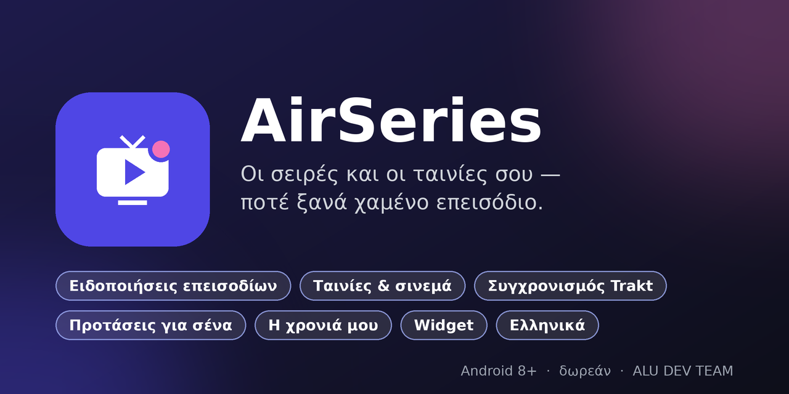

# 📺 AirSeries

**Οι σειρές και οι ταινίες σου — ποτέ ξανά χαμένο επεισόδιο.**

Android εφαρμογή που σε ειδοποιεί όταν βγαίνει νέο επεισόδιο, κρατά την πρόοδό σου,
σου προτείνει τι να δεις και συγχρονίζεται με το Trakt.

<!-- SCREENSHOTS -->

---

## ✨ Τι κάνει

### 📺 Σειρές
| | |
|---|---|
| 🔔 **Ειδοποιήσεις** | Στην ώρα προβολής ή 15′ / 1 ώρα / 3 ώρες πριν, με εικόνα και κουμπί **«✓ Το είδα»** μέσα στην ειδοποίηση |
| ☀️ **Πρωινή σύνοψη** | Μία ειδοποίηση την ημέρα με όλα τα σημερινά επεισόδια (διαλέγεις ώρα) |
| 📣 **Ανακοινώσεις** | Όταν μια σειρά παίρνει ημερομηνία για νέα σεζόν |
| ✅ **Ένα tap = ειδωμένο** | ✓ στη «Συνέχεια» (με Αναίρεση) · παρατεταμένο πάτημα → «όλα μέχρι εδώ» |
| 📊 **Πρόοδος** | `18/36` ανά σειρά και σεζόν, πόσα σου μένουν, ώρες τηλεόρασης |
| 🗂️ **Λίστες** | Βλέπω · Θα δω · Σε παύση · Παράτησα |
| ⭐ **Η γνώμη μου** | Αστέρια 1–5 και προσωπική σημείωση σε κάθε σειρά |
| 🎭 **Ηθοποιοί & trailer** | Πάτα έναν ηθοποιό και δες πού αλλού παίζει · trailer στο YouTube |
| 📍 **Πού να το δω** | JustWatch Ελλάδας και η πλατφόρμα της σειράς |
| 🙈 **Χωρίς spoilers** | Θολώνει εικόνες/περιγραφές επεισοδίων που δεν έχεις δει |
| 🇬🇷 **Μετάφραση** | Περιγραφές στα ελληνικά, μέσα στο κινητό (λειτουργεί και offline) |

### 🎬 Ταινίες (TMDB)
| | |
|---|---|
| 🔎 **Αναζήτηση & λίστες** | Θα δω / Τις είδα, Τώρα στους κινηματογράφους, Έρχονται σύντομα, Δημοφιλείς |
| 🗓️ **Κυκλοφορία στην Ελλάδα** | Ημερομηνία κινηματογράφων και online — ειδοποίηση τη μέρα που βγαίνει |
| 📺 **Πού παίζει** | Συνδρομή / δωρεάν / ενοικίαση / αγορά στην Ελλάδα, με λογότυπα |

### 🤝 Γενικά
| | |
|---|---|
| 🤖 **Προτάσεις για σένα** | Με βάση είδη, ηθοποιούς, γλώσσα, κανάλι και τα αστέρια σου |
| 🔄 **Trakt** | Σύνδεση με κωδικό, συγχρονισμός ειδωμένων και watchlist και προς τις δύο μεριές |
| 📥 **Εισαγωγή** | Από Trakt (.zip) ή λίστα ονομάτων (TV Time κ.λπ.) |
| 📈 **Η χρονιά μου** | Στατιστικά, ρεκόρ μαραθωνίου, κάρτα για κοινοποίηση |
| 🧩 **Widget** | Επόμενα επεισόδια στην αρχική οθόνη, με ✓ |
| 📤 **Κοινοποίηση** | Κάρτα-εικόνα με poster και πρόοδο για Viber / WhatsApp / Instagram |
| 💾 **Backup** | Αρχείο αντιγράφου + αυτόματο backup στο Google |
| 🌗 **Εμφάνιση** | Ελληνικά / English, φωτεινό / σκοτεινό, δυναμικά χρώματα |
| ⬆️ **Αυτόματες ενημερώσεις** | Νέα έκδοση από τα GitHub Releases με ένα πάτημα |

---

## 🚀 Εγκατάσταση

1. Από το κινητό άνοιξε τα **[Releases](https://github.com/nikkpap/AirSeries/releases/latest)** και πάτα **AirSeries.apk**.
2. Άνοιξε το αρχείο → **Εγκατάσταση** (αν ζητηθεί, επίτρεψε «άγνωστες πηγές»).
3. Πάτα **Επίτρεψη** στις ειδοποιήσεις.
4. **Ανακάλυψη** → γράψε μια σειρά → **+**.
5. *(Προαιρετικά)* **Ρυθμίσεις → Trakt → Σύνδεση με Trakt** για να φέρεις το ιστορικό σου.

> 💡 Σε Samsung / Xiaomi / Huawei: **Ρυθμίσεις → Μπαταρία → Διόρθωση**, ώστε οι ειδοποιήσεις να έρχονται στην ώρα τους.

Οι επόμενες εκδόσεις έρχονται **μόνες τους** μέσα από την εφαρμογή.

---

## 🛠️ Για developers

- Kotlin 2.1 · Jetpack Compose (Material 3) · Room · WorkManager · Retrofit · Coil · Glance · ML Kit
- minSdk 26 (Android 8) · targetSdk 35 · package `gr.nikkpap.airseries`
- Κάθε push στο `main` → GitHub Actions φτιάχνει το υπογεγραμμένο APK και βγάζει νέο Release.

Secrets του repo: `KEYSTORE_PASSWORD`, `KEY_ALIAS`, `KEY_PASSWORD` (υπογραφή), `TMDB_API_KEY` (ταινίες), `TRAKT_CLIENT_ID` (Trakt).
Για τοπικό build: άνοιξε τον φάκελο στο **Android Studio** και πάτα ▶ — όλες οι βιβλιοθήκες κατεβαίνουν αυτόματα.

---

Δεδομένα σειρών: [TVmaze](https://www.tvmaze.com) (CC BY-SA 4.0) · Ταινίες: [TMDB](https://www.themoviedb.org) — *This product uses the TMDB API but is not endorsed or certified by TMDB.* · Διαθεσιμότητα streaming: JustWatch · Συγχρονισμός: [Trakt](https://trakt.tv)

**© 2026 ALU DEV TEAM · Nikolaos K. Paridis (aka nikkpap)**

